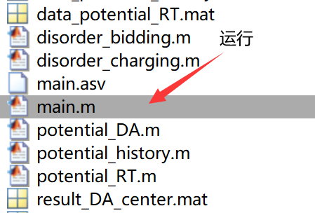
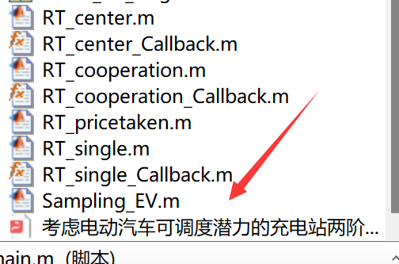
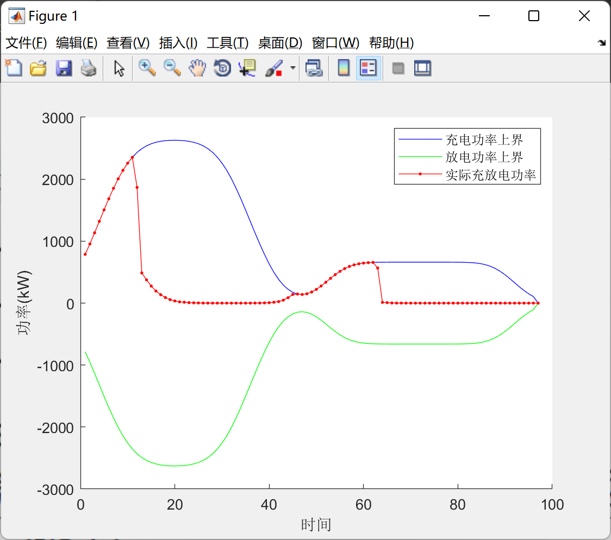
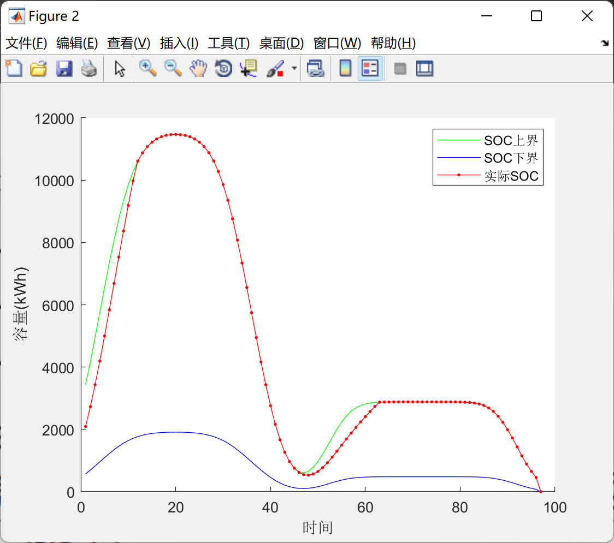
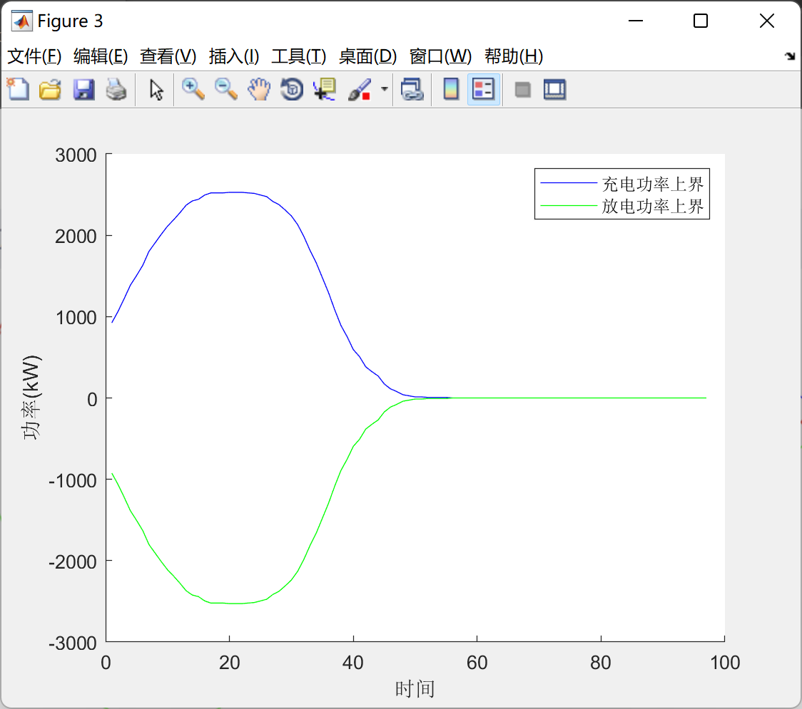
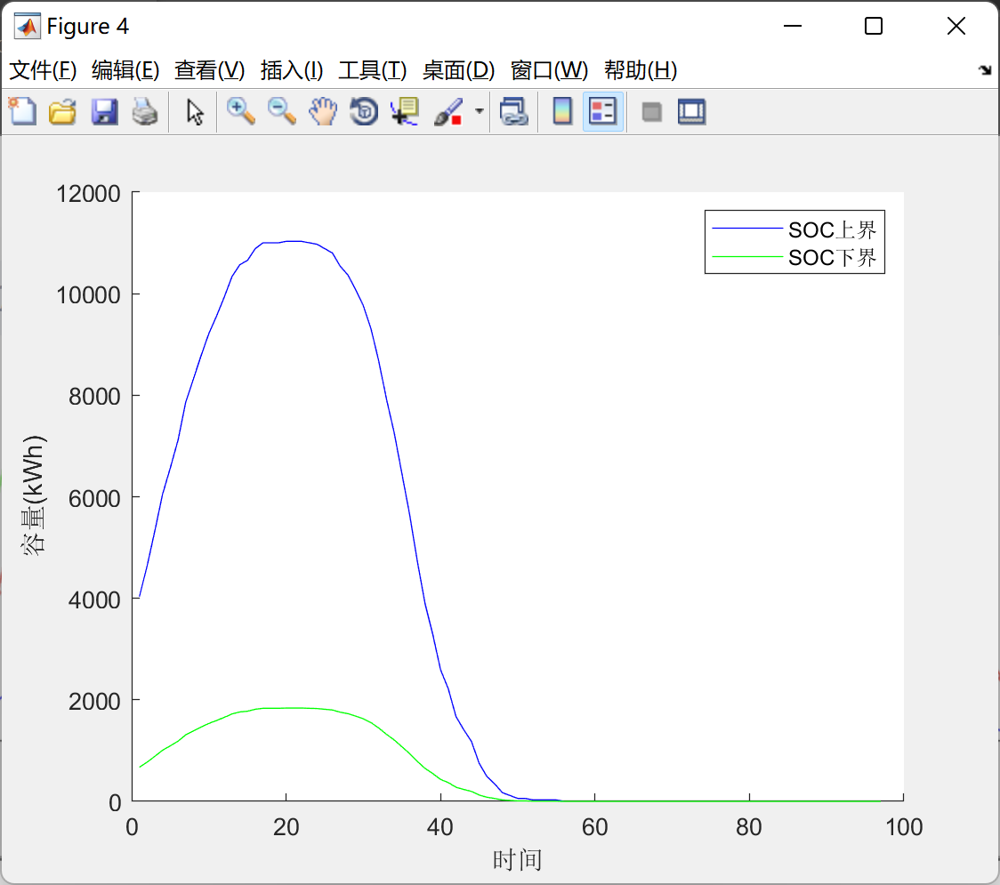
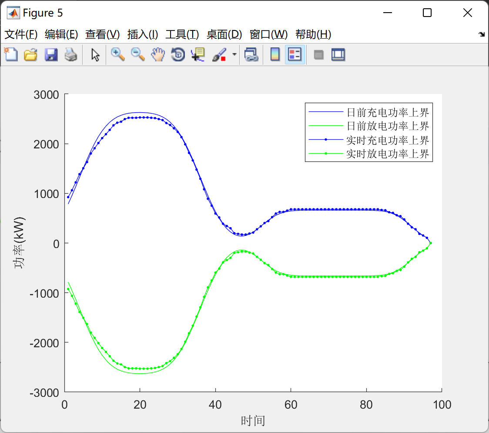
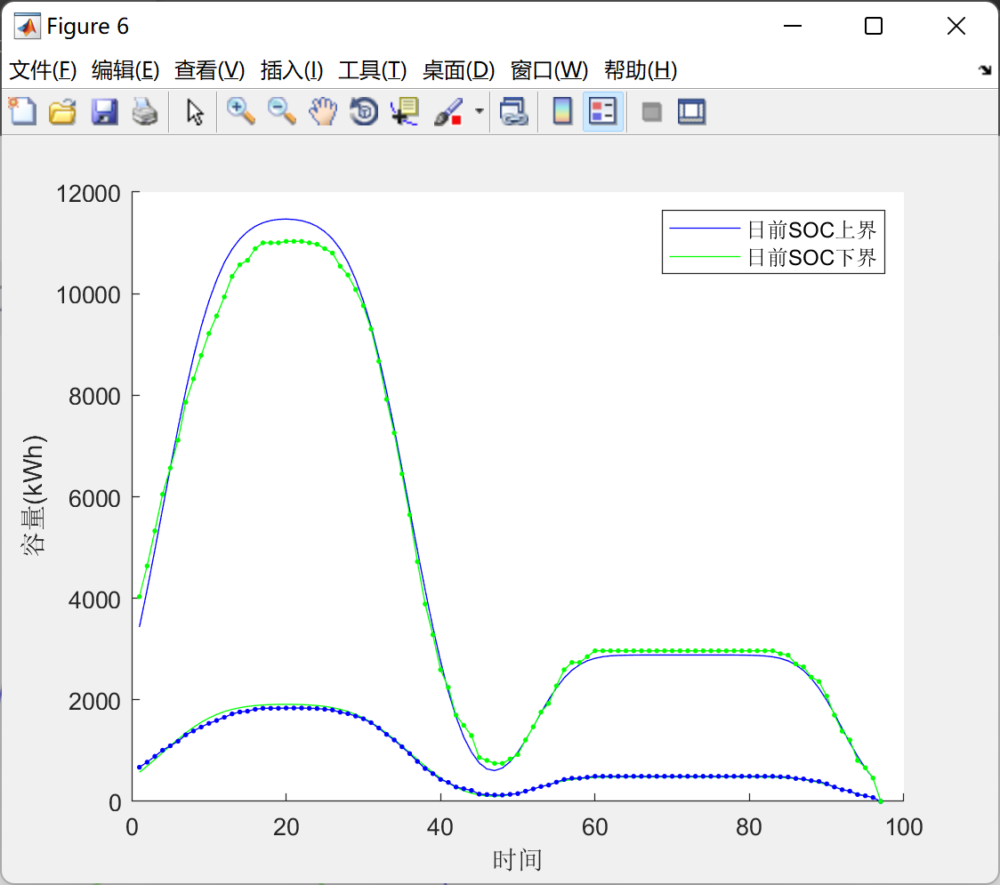
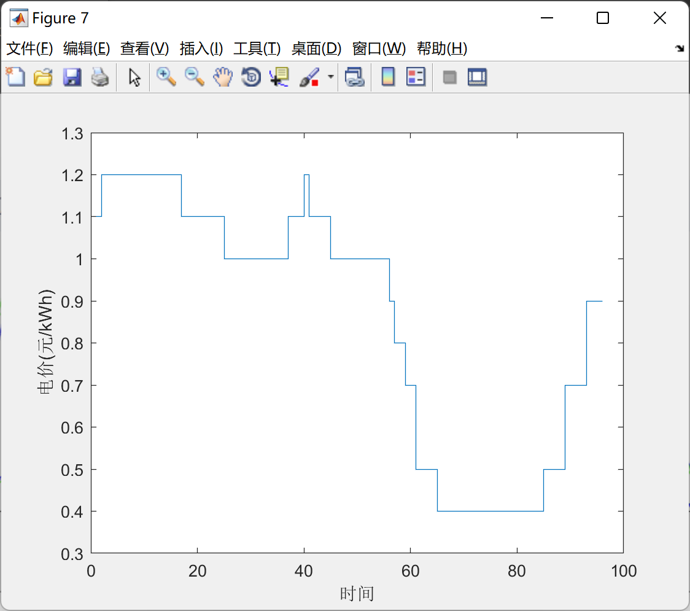
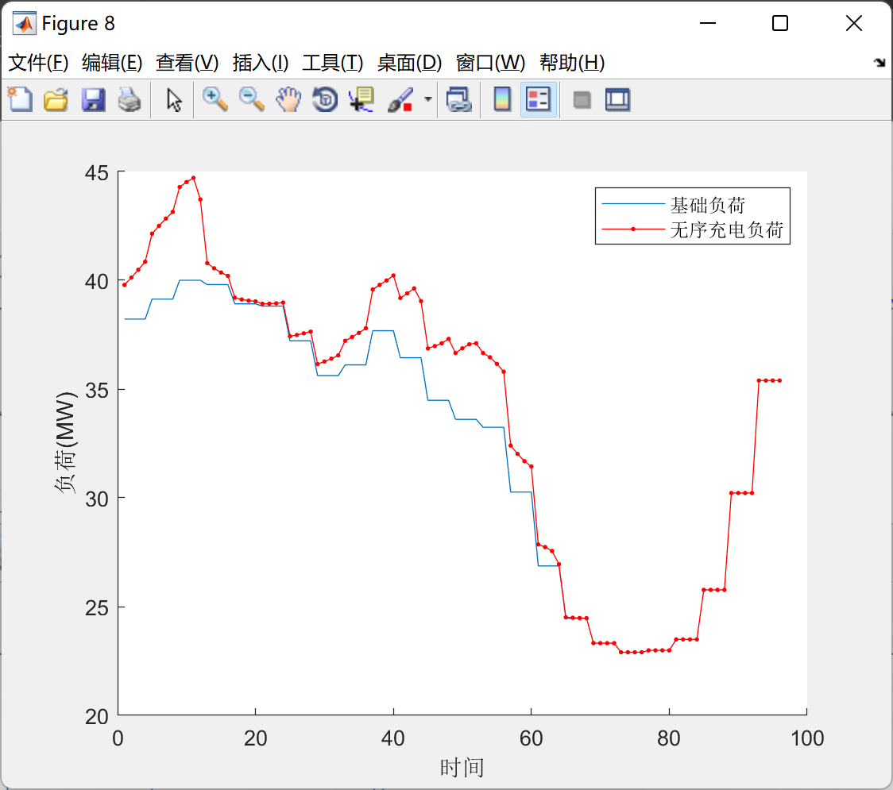

# Two-Stage Optimized Dispatching of Electric Vehicles (Matlab Code + Data + Comprehensive Guide)

Two-stage optimization dispatching for electric vehicles (Matlab code + data + detailed explanation in the article)
\n        \n  
\n        \n      \n        \n      \n        \n      \n        \n      \n        \n      \n        \n      \n        \n      \n        \n      \n        \n      \n        \n  

## Images

<!-- PAYMENT_BLOCK -->

## Get this dataset

- Payment link (Stripe): [Buy now](https://buy.stripe.com/3cs8yP7sY87d0vu9AB)
- Payment QR code: 

<!-- /PAYMENT_BLOCK -->
